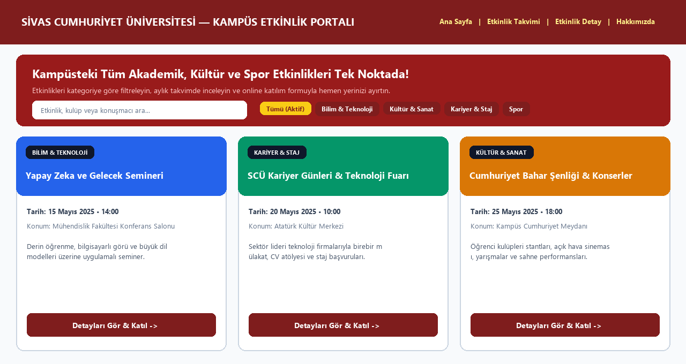

# 🎓 Sivas Cumhuriyet Üniversitesi — Kampüs Etkinlik Portalı


Sivas Cumhuriyet Üniversitesi kampüsünde düzenlenen akademik seminerleri, kariyer günlerini, kültür-sanat festivallerini ve spor etkinliklerini tek bir çatı altında listeleyen, kategoriye göre filtreleyen ve interaktif aylık takvim üzerinde gösteren modern web uygulaması.



---

## ✨ Öne Çıkan Özellikler

* **🔍 Anlık Arama ve Kategori Filtreleme:** Bilim & Teknoloji, Kültür & Sanat, Kariyer ve Spor etkinlikleri arasında sayfa yenilenmeden dinamik filtreleme.
* **📅 İnteraktif Aylık Takvim (`takvim.html`):** Etkinlik yoğunluğunu gün bazında görüntüleme ve ilgili güne tıklayarak etkinlik detayına geçiş.
* **📝 Dinamik Etkinlik Detay ve Katılım Formu (`etkinlik-detay.html`):** URL parametreleriyle JSON veri kaynağından (`veri/etkinlikler.json`) beslenen detay sayfası ve öğrenci kayıt formu.
* **📱 Tam Duyarlı (Responsive) Tasarım:** CSS Variables, Flexbox ve CSS Grid mimarisiyle masaüstü, tablet ve mobil cihazlara tam uyum.

---

## 📁 Sayfa ve Klasör Yapısı

```text
CU-etkinlik-Portali/
├── index.html            # Ana Sayfa (Hero, arama, kategori filtreleme ve etkinlik kartları)
├── etkinlik-detay.html   # Dinamik etkinlik detayları, konuşmacı bilgisi ve katılım formu
├── takvim.html           # Aylık interaktif etkinlik takvimi görünümü
├── hakkimizda.html       # Portal ve Sivas Cumhuriyet Üniversitesi tanıtım sayfası
├── css/                  # Modüler stil dosyaları ve duyarlı (responsive) tasarım kuralları
├── js/                   # JSON veri çekme (fetch), filtreleme ve takvim algoritmaları
├── veri/                 # Etkinlik veri seti (JSON)
└── gorseller/            # Kurumsal logo ve etkinlik görselleri
```

---

## 🚀 Kurulum ve Çalıştırma

Uygulama etkinlik verilerini `fetch` API ile JSON dosyasından okuduğu için yerel bir HTTP sunucusu ile çalıştırılmalıdır:

```bash
# Seçenek 1: Python yerleşik sunucusu ile başlatma
python -m http.server 8000
# Tarayıcıda açın: http://localhost:8000

# Seçenek 2: VS Code Live Server eklentisi
# index.html dosyasına sağ tıklayıp "Open with Live Server" seçeneğine tıklayın.
```

---

## 👨‍💻 Geliştirici
* **Hazırlayan:** Eren Sezer — Sivas Cumhuriyet Üniversitesi, Bilgisayar Mühendisliği Bölümü
* **GitHub:** [@erensezer07-gif](https://github.com/erensezer07-gif)
